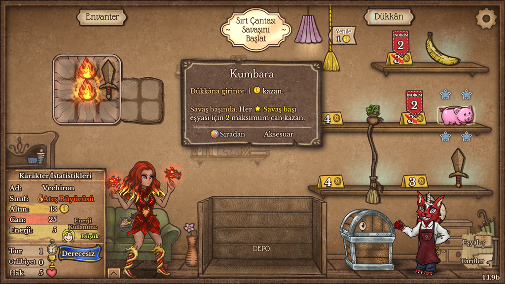
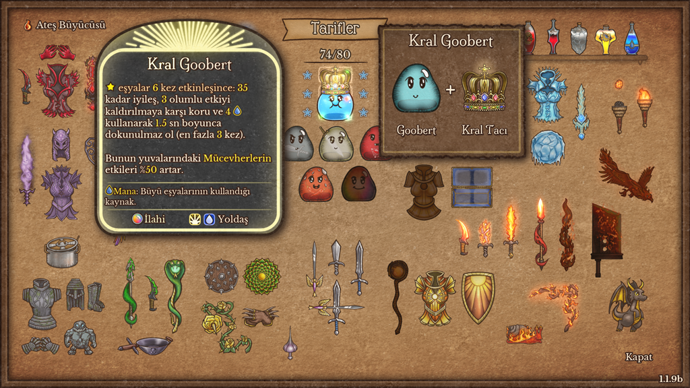
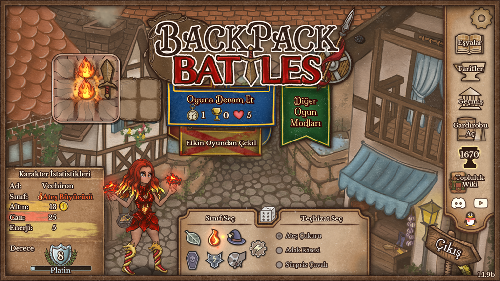
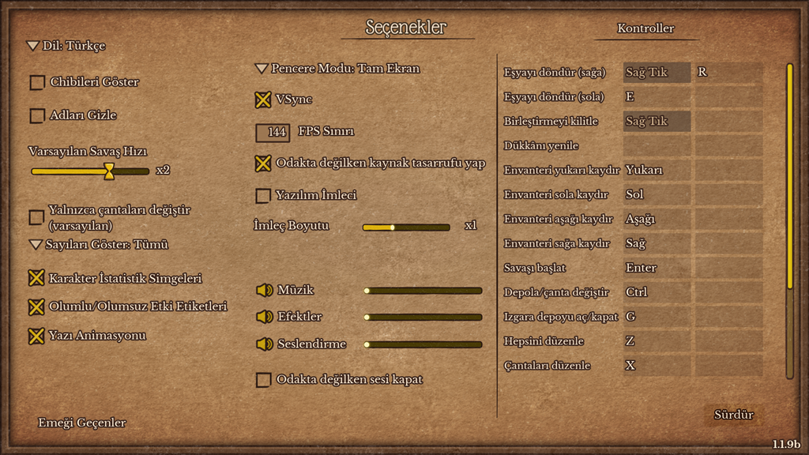
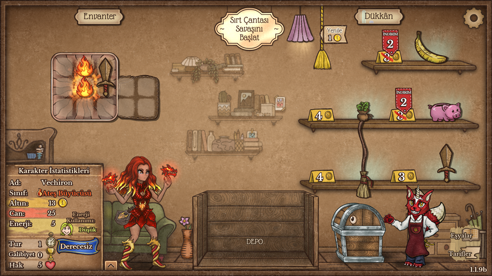

# Backpack Battles TR: Backpack Battles Türkçe çevirisi

Backpack Battles'ın bütün metni Türkçe: menüler, eşya adları, etkileri ve hikâyeleri, anahtar kelimeler, öğretici, konuşmalar. Oyun Türkçe açılır, Seçenekler'deki dil satırında "Dil: Türkçe" yazar. Gönüllü bir hayran çevirisidir, oyunun geliştiricileriyle bir bağı yoktur.

  
  

Hazırlayan: **Vechiron**

### ⬇ [Kurulum dosyasını indir (BackpackBattlesTR-Kurulum.exe)](https://github.com/vechiron/BackpackBattles-TR/releases/latest/download/BackpackBattlesTR-Kurulum.exe)

Tüm sürümler: [Releases](https://github.com/vechiron/BackpackBattles-TR/releases)

## Gereksinimler

- Backpack Battles, Windows (test edilen sürüm: 1.1.9b, Steam)

Başka bir şey gerekmez; Node.js ya da başka bir program kurmanız gerekmez. Oyunu daha önce hiç açmamış olmanız sorun değil: kurulum programı oyunun dil ayarı dosyasını Steam hesabınız için kendisi oluşturur.

## Kurulum (3 adım)

1. **[BackpackBattlesTR-Kurulum.exe](https://github.com/vechiron/BackpackBattles-TR/releases/latest/download/BackpackBattlesTR-Kurulum.exe)** dosyasını indirin. Nereye indirdiğiniz önemli değil.
2. Oyun kapalıyken çalıştırın. Windows "Bilinmeyen yayımcı" (SmartScreen) uyarısı verirse **Ek bilgi > Yine de çalıştır** deyin; program dijital olarak imzalı olmadığı için bu uyarı normaldir.
3. Pencerede **Tamam: Türkçe kuruldu** yazınca bir tuşa basıp pencereyi kapatın. Oyun klasörü Steam'in kayıtlarından otomatik bulunur; bulunamazsa program söyler: exe'yi oyun klasörüne (`BackpackBattles.exe`'nin yanına) taşıyıp yeniden çalıştırın (Steam'de oyuna sağ tıklayın > **Yönet > Yerel dosyalara göz at**). Oyunu açın, hepsi bu.

**Kaldırmak için** programı yeniden çalıştırın: Türkçe kuruluysa program sorar, `K` yazıp Enter'a basınca Türkçe kaldırılır ve oyun eski diline döner (yalnızca Enter yeniden kurar). Elle kaldırmak için oyun klasöründeki `override.cfg` dosyasını silmek yeter.

**Yazılar Türkçe görünmüyorsa:** Türkçe oyunun dil listesinde yoktur; menüden başka bir dil seçtiyseniz programı yeniden çalıştırıp Enter'a basın, oyun yine Türkçe açılır.

**Oyun güncellenirse:** programı yeniden çalıştırıp Enter'a basın; Türkçe oyunun yeni sürümüne taşınır. Güncellemede İngilizcesi değişen metinler yamanın yeni sürümüne kadar İngilizce görünür.

Bu yüzden indirdiğiniz dosyayı saklayın (silerseniz yeniden indirmeniz yeter). Program komut satırından da kullanılabilir: `BackpackBattlesTR-Kurulum.exe kur`, `kaldir` ya da `bul` (oyun klasörünü yalnızca gösterir); komutla çalışınca sonda tuş beklemez.

## Antivirüs uyarısı

Bazı antivirüsler kurulum programını "şüpheli" olarak işaretleyebilir. Bu bir yanlış alarmdır. Programın yapısı antivirüslerin gözünde zararlı yazılımlara benzer:

- İçinde başka bir program taşır: resmî Node.js v24.22.1 programını (nodejs.org'dan, değiştirilmeden) ve kurulum betiklerini sıkıştırılmış olarak taşır; çalışınca bunları geçici bir klasöre açar, iş bitince siler. Dosyanın yaklaşık 34 MB olmasının nedeni budur.
- Oyunun klasörüne dosya ekler ve oyunun ayar dosyasını değiştirir.
- Dijital olarak imzalı değildir.

Kurulum programının bütün kaynak kodu bu depodadır.

İndirdiğiniz dosyanın buradaki sürüm olduğunu karmasıyla doğrulayabilirsiniz: dosyanın bulunduğu klasörde PowerShell'e `Get-FileHash .\BackpackBattlesTR-Kurulum.exe` yazın. Çıkan değer aşağıdakiyle aynı olmalıdır (büyük/küçük harf fark etmez).

| dosya (v1.0.0) | SHA-256 |
|---|---|
| `BackpackBattlesTR-Kurulum.exe` | `70358fd5537078c4695bccad97234f27b7b11e708af3e211b6e926bd6d691a82` |
| `Node.js-LICENSE.txt` | `ed34dd8e3f0a78dbaf00d0444ce8e285b015b765379c2e17880455f70370f8e9` |

## İngilizce kalanlar

- Oyun logosu ve açılıştaki "Loading..." yazısı (resmin içine çizilmiş yazılar).

## Ekran görüntüleri

  
  
  

## Nasıl çalışır?

- Oyun Godot motoruyla yapılmış. Motor, oyun klasöründeki `override.cfg` dosyasıyla bazı ayarların değiştirilmesine izin verir; program bu dosyaya Türkçe çeviri dosyalarının yerini yazar. Oyunun paketine (`BackpackBattles.pck`) ve öteki dosyalarına dokunmaz.
- Türkçe metinlerden oyunun okuduğu çeviri dosyalarını (`.translation`) kurulum anında üretir ve oyun klasöründeki `turkce` klasörüne yazar.
- Oyunun dil ayarını (`%APPDATA%\Godot\app_userdata\Backpack Battles\<Steam hesabı>\full\backpack.cfg`) Türkçe yapar, kaldırırken eski değeri geri koyar. Oyun hiç açılmamışsa bu dosyayı oyunun ilk açılışta yazdığı biçimde oluşturur, kaldırırken siler.
- Ne yaptığını `turkce\kurulum.json` dosyasına yazar; kaldırırken yalnızca kendi yazdığı ve sonradan değişmemiş dosyaları siler. Oyun açıksa hiçbir şey yazmaz.
- Kurulum programı (`tools/kurucu/Kurucu.cs`) küçük bir C# başlatıcıdır, Windows'ta yerleşik .NET Framework 4 ile derlenir. İçine Node.js, `tools/` ve `ceviri/tr/` sıkıştırılmış olarak gömülür; çalışınca bunları geçici bir klasöre açar, `tools/paket-kur.mjs`'yi çalıştırır, sonra klasörü siler. Yönetici izni istemez.
- Node.js kuruluysa program olmadan da çalışır: depoyu indirip `node tools/paket-kur.mjs oto`.
- Çeviri yalnızca sizin bilgisayarınızdaki oyunu etkiler.

## Depo düzeni

| yer | ne |
|---|---|
| `tools/paket-kur.mjs` | kurulum programının girişi: oyunu bulur, Türkçeyi kurar ya da kaldırır |
| `tools/override-kur.mjs` | kurulumun kendisi: çeviri dosyalarını üretir, `override.cfg`'yi ve dil ayarını yazar, kaldırırken geri alır |
| `tools/` öteki dosyalar | ikisinin kullandığı yardımcılar: oyunun çeviri dosyası biçimi, oyun paketini okuma, Türkçe metin denetimi, oyun güncellenince taşıma |
| `tools/kurucu/Kurucu.cs` | kurulum programının exe'si (C# başlatıcı) |
| `ceviri/tr/` | Türkçe metinler, oyunun çeviri tablosu başına bir dosya; her kayıtta İngilizce metnin kendisi değil, yalnızca 16 haneli karması durur, oyun güncellenince hangi metnin değiştiğini program bununla anlar |
| `gorseller/` | bu sayfadaki ekran görüntüleri (oyundan) |

## Sorun bildirme

Çeviri yapay zekâ desteğiyle (Claude) yapıldı ve oyunda denendi. Yanlış ya da tuhaf bir metin ya da kurulum hatası görürseniz [Issues](https://github.com/vechiron/BackpackBattles-TR/issues) sayfasından bildirin; kurulum hatasında penceredeki satırları da ekleyin.

## Lisans

- Kod (`tools/`): MIT lisanslı, © 2026 Vechiron (bkz. `LICENSE`).
- Türkçe metinler (`ceviri/tr/`) gönüllü hayran çevirisidir. Backpack Battles'ın adı, görselleri ve özgün metinleri üzerindeki bütün haklar sahiplerine aittir; ekran görüntüleri oyundandır. Bu depo ve kurulum programı oyunun hiçbir dosyasını içermez; İngilizce metinlerin yerine yalnızca karmaları durur.
- Kurulum programı Node.js'i (MIT) içerir; lisansı `Node.js-LICENSE.txt`, sürüm sayfasında exe ile birlikte.
